<div align="center">

# 💊 MediTrack

### AI-assisted medication adherence and a privacy-first caregiver companion

Scan a prescription, never miss a dose, and let the people who care about you help, **seeing only what you allow**.


</div>

> **Status:** Phases 0–11 are built and verified locally. Phase 12 (hardening, deployment, demo) is in progress. MediTrack is **not deployed** yet and is **not a medical device**.

---

## At a glance

| | |
|---|---|
| **3 services** | React client · Node/Express API · Python FastAPI OCR service, plus PostgreSQL, Redis and a mail catcher |
| **20 database models** | Fully relational schema managed with Prisma migrations |
| **99.31 % field accuracy** | PaddleOCR, picked after benchmarking 3 engines on 15 prescriptions (45 runs) |
| **0.10 % character error rate** | vs 1.54 % (Tesseract) and 2.02 % (EasyOCR) |
| **122 automated checks** | 33 backend integration + 20 client unit + 69 Playwright browser tests, with 2 more opt-in tests skipped |
| **≈ 1 second** | Measured time for a caregiver's screen to update after the patient taps "Taken", with no reload |
| **3 permission levels** | `full_access`, `view_only`, `alerts_only`, enforced from the database on every request |
| **2-minute escalation job** | Patient reminder first, then a live alert to caregivers after a 30-minute grace period |
| **30 reviewed interaction pairs** | Transcribed from DailyMed drug labels and never generated by AI |
| **13 medicine forms** | Tracked as countable units, millilitres or grams, with automatic run-out prediction |
| **144 kB gzip** | Production JavaScript bundle (476.66 kB raw), CSS 33 kB |

---

## The problem

Missed doses are common, and the people who could help are either told nothing or told too much. The hard part isn't reminders. It's **privacy**: the same person can be a *patient* in one relationship and a *caregiver* in another, and each patient should decide exactly what each caregiver sees.

MediTrack treats that as the core design problem. Everything else (OCR, schedules, alerts, AI) is built around it.

---

## Screenshots

### Daily dose tracking

<p align="center">
  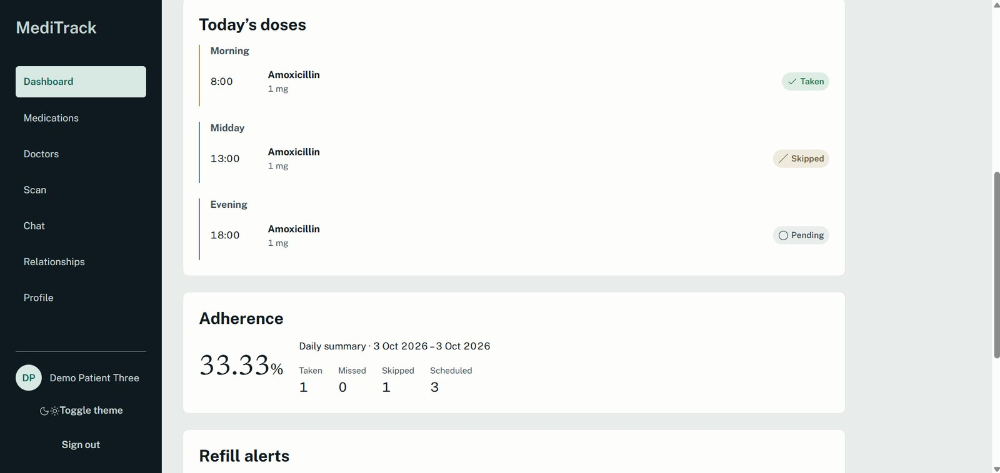
  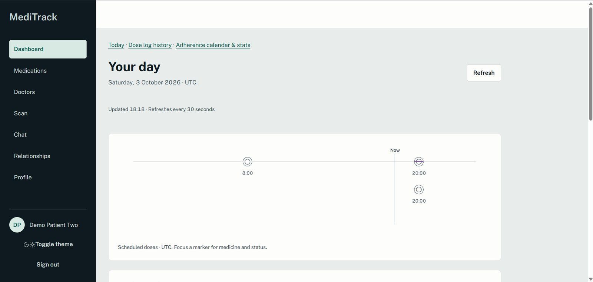
</p>
<p align="center"><sub>Today's doses grouped by time of day, with live adherence, and a day timeline with a "now" marker. Times use the patient's own timezone.</sub></p>

<p align="center">
  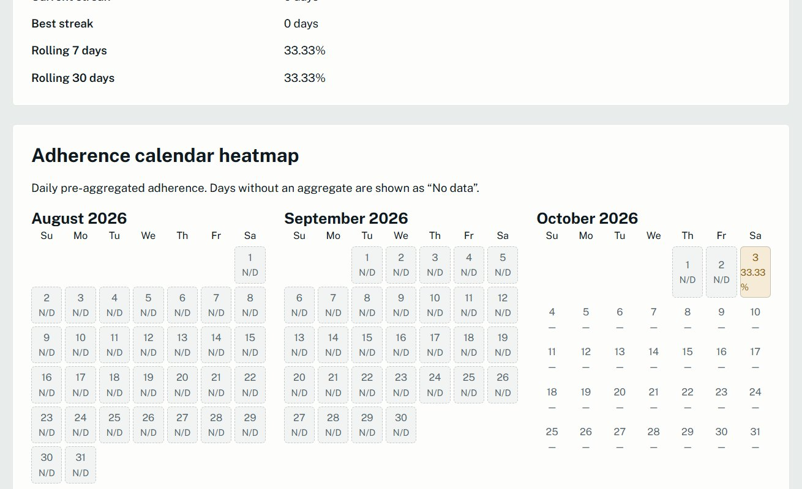
</p>
<p align="center"><sub>Adherence calendar heatmap, colour-coded 0 % / 1–49 % / 50–99 % / 100 %. Days with no data say "no data" instead of pretending to be 0 %.</sub></p>

### Prescription scan with mandatory human review

<p align="center">
  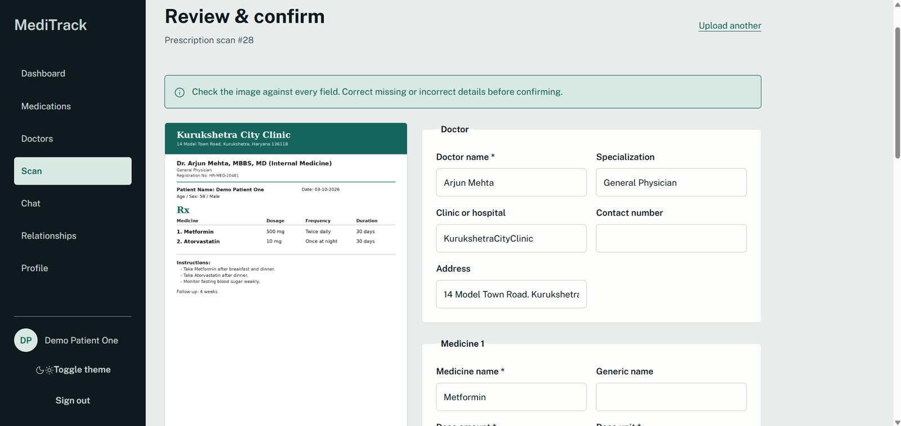
</p>
<p align="center"><sub>PaddleOCR extracts the doctor and medicines. The user checks every field against the original image before anything is saved. OCR output is never trusted blindly.</sub></p>

### Medicines, schedules and inventory

<p align="center">
  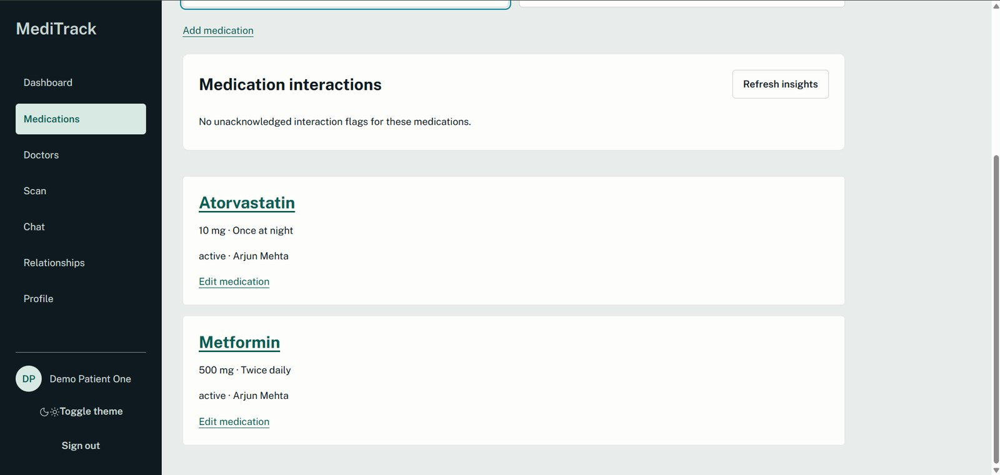
  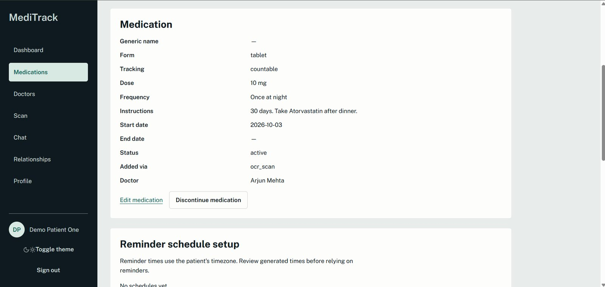
</p>
<p align="center">
  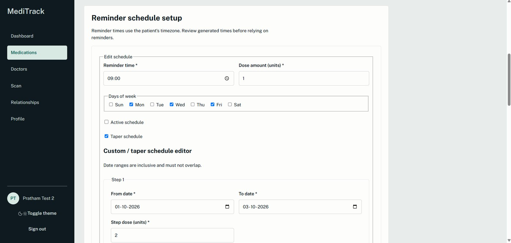
  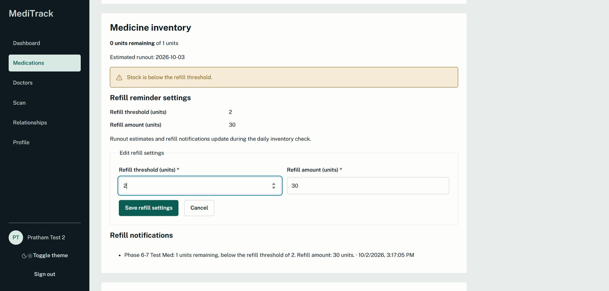
</p>
<p align="center"><sub>Medicine list and detail (marked as added via OCR), schedule editor with custom taper steps, and inventory with refill thresholds, run-out estimate and low-stock warning.</sub></p>

<p align="center">
  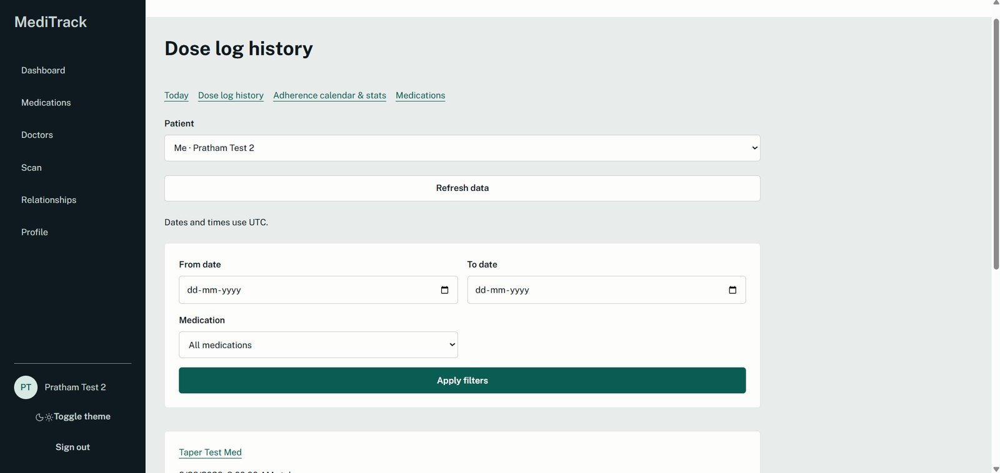
</p>

### Drug-interaction safety

<p align="center">
  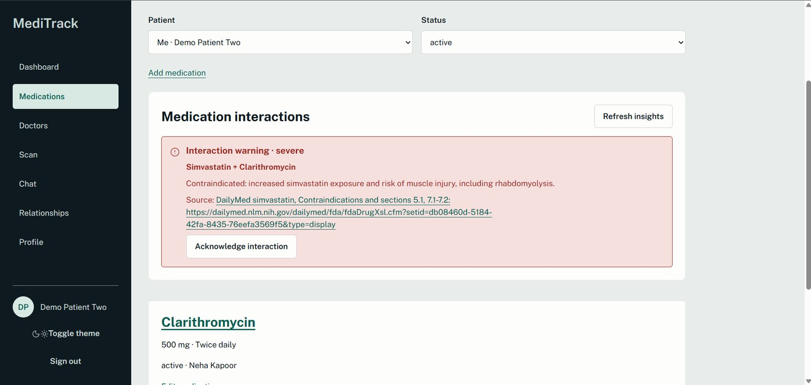
  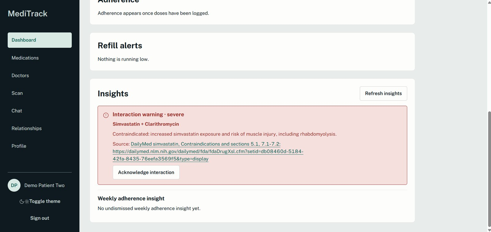
</p>
<p align="center"><sub>Simvastatin + Clarithromycin raises a severe warning with a link to the DailyMed label it came from, and the user must acknowledge it. Warnings come only from the reviewed 30-pair dataset, never from the AI.</sub></p>

### Caregivers, permissions and live alerts

<p align="center">
  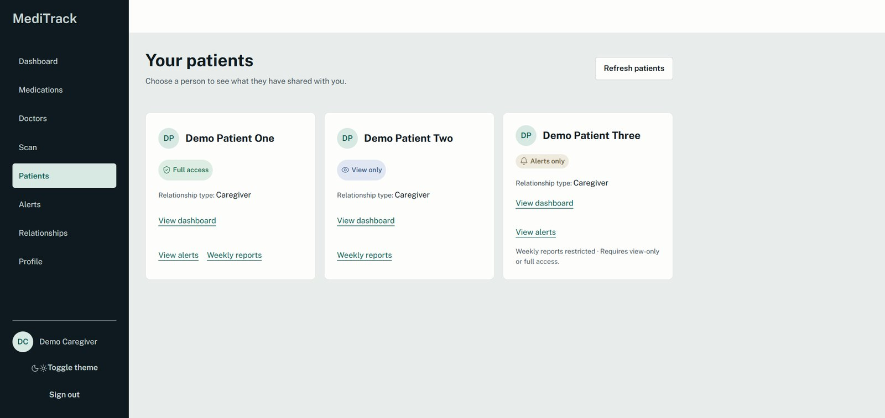
  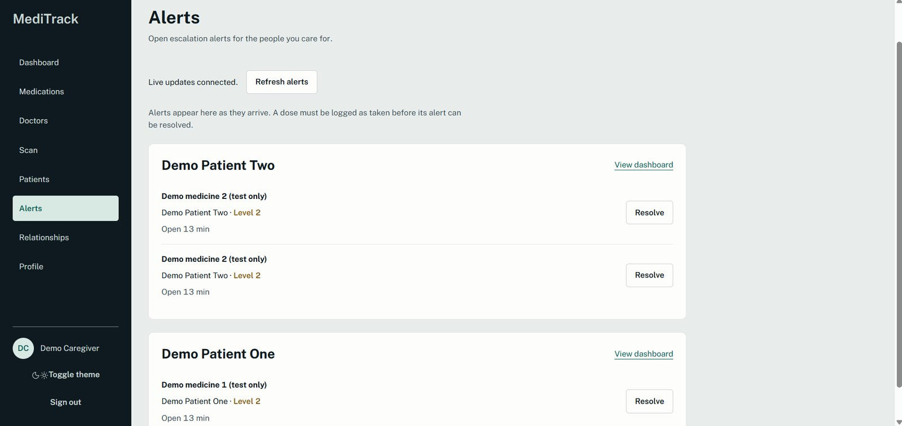
</p>
<p align="center"><sub>One caregiver, three patients, three different permission levels. Restricted sections say so instead of leaking data. Missed-dose alerts arrive over an authenticated WebSocket and can only be resolved once the dose is actually logged.</sub></p>

<p align="center">
  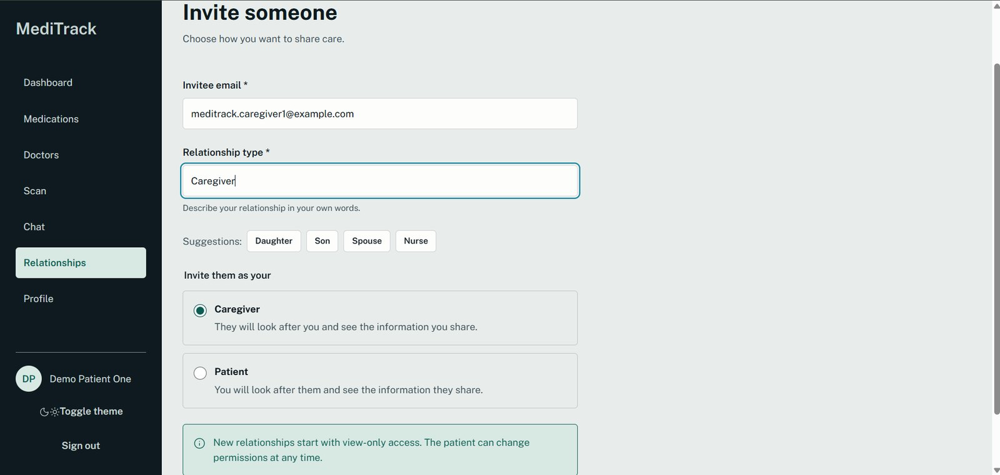
  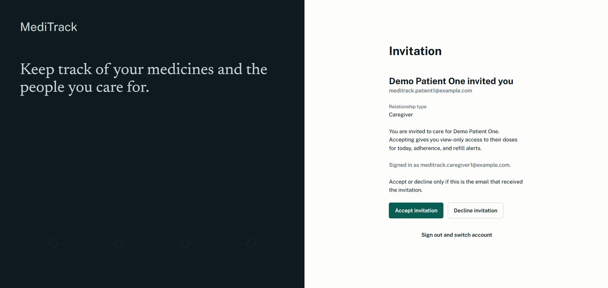
</p>
<p align="center">
  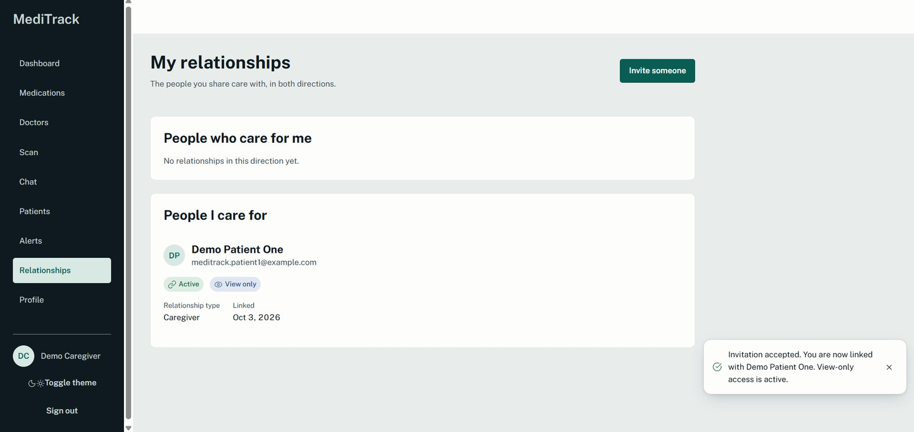
</p>
<p align="center"><sub>Invite by email, accept or decline, and every new link starts at <code>view_only</code>. The patient chooses whether to widen it. The relationships page shows both directions: people who care for me and people I care for.</sub></p>

### AI chat with a forced disclaimer

<p align="center">
  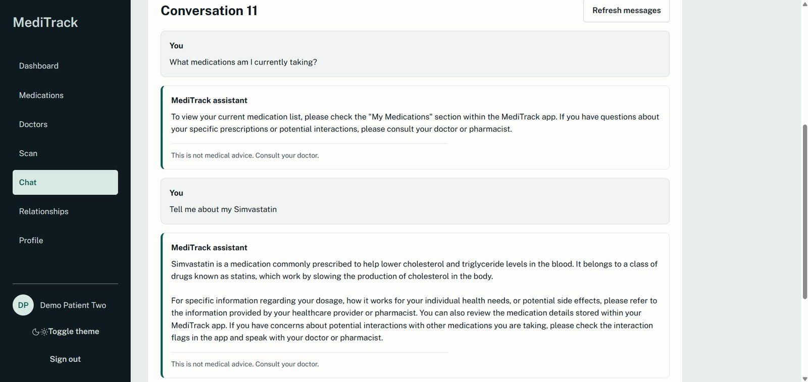
</p>
<p align="center"><sub>Private, owner-only chat grounded in the user's own medicines. Every reply carries the disclaimer, enforced in code and not left to the model.</sub></p>

---

## Features

### For patients
- **Sign up and sign in** with email and password (email verification and password reset) **or Google Sign-In**. Both use the same identity system and never create duplicate accounts.
- **Scan a prescription**: upload an image, OCR runs in the background (a 6–12 s job that never blocks the app), a live event tells you when it is done, then you review and confirm.
- **Add medicines manually** when there is no prescription (OTC, supplements, lost paper). Same data model, same security.
- **Schedules** written by hand, **generated by AI from the instructions** ("twice daily after meals") for you to edit, or custom **taper** schedules with dated steps.
- **Dose logging**: taken, skipped or snoozed, with an atomic inventory decrement.
- **Inventory**: countable, millilitre and gram tracking across 13 medicine forms, with run-out prediction, refill thresholds and refill notifications.
- **Adherence**: daily percentage, rolling 7 and 30 days, current and best streak, and a calendar heatmap.
- **Interaction warnings** when two of your medicines appear on the reviewed interaction list, with the source label attached.
- **AI chat** that knows your medicines and warnings, plus a short **weekly insight** computed from your counts.
- **Notification inbox**, per-channel preferences, an **account-activity page** showing exactly who read your data and when, a support form, and FAQ and legal pages.

### For caregivers
- **Multi-patient dashboard** with a patient switcher, showing only what each patient shared.
- **Live missed-dose alerts** over Socket.io, delivered only to caregivers whose permission allows alerts, with the permission re-checked at the instant of sending.
- **Weekly AI summary reports**, emailed, whose numbers are computed in code and cannot be invented by the model.
- **Alerts feed** with resolve, which is only allowed after the dose has actually been logged.

### Platform
- **Live refresh**: any data change updates every relevant open screen within about a second through a tiny `data-changed` event. The event carries ids only and the client refetches through permission-checked REST.
- **Background jobs** for dose-log creation (with catch-up after downtime), escalation, inventory and refill checks, daily and weekly adherence, and weekly reports.
- **Honest health check**: `/api/health` really pings Postgres and Redis and returns 503 if either is down.
- **Responsive and accessible UI**: tested at 360, 768 and 1280 px in light and dark themes, with keyboard navigation and automated axe accessibility checks.

---

## Safety and privacy by design

| Principle | How it is enforced |
|---|---|
| **No role column** | "Patient" and "caregiver" are roles of a *link* between two accounts, not of a person. Authority is checked per link row. |
| **Permissions live in the database** | `checkPermission` runs on **every** caregiver read. A downgrade or revoke applies on the very next request, even with the same token. |
| **Absent, not null** | Restricted fields are *missing* from the response and the queries are not even run. A test stringifies the whole response to prove nothing leaks. |
| **AI has no tools** | Gemini is called server-side only, with no function calling, temperature 0, and untrusted text clearly separated from instructions. The API key never reaches the browser. |
| **AI cannot invent medical facts** | Interaction data is a static, hand-reviewed dataset. The seed script refuses to overwrite a drifted row. Weekly reports must begin with a code-computed sentence and may not introduce a new number. |
| **Forced disclaimer** | `disclaimerShown` is true on every chat message, and the disclaimer text is prepended in code if the model omits it. |
| **OCR always needs a human** | Scans go `processing → needs_review → completed`. They can't skip review. |
| **Race-safe by construction** | Two simultaneous invitation accepts give exactly one success and one conflict. Overlapping jobs create no duplicate alerts or reports. |
| **Revoked means revoked** | Hidden notifications are restored if access is restored. A hidden item returns the same 404 as a missing one, so existence doesn't leak. |
| **Auditable** | Caregiver reads and permission changes are logged (metadata only, never medical content), and patients can see them. |
| **Dev backdoors disabled in production** | Dev-only routes return 404 when `NODE_ENV=production`. |

### What each caregiver level can do

| Capability | `full_access` | `view_only` | `alerts_only` |
|---|:-:|:-:|:-:|
| Dashboard | full | full | refill alerts only |
| Medicines, doctors, schedules, inventory (read) | ✅ | ✅ | ❌ |
| Same (write) | ✅ | ❌ | ❌ |
| Dose logs and adherence | ✅ | ✅ | ❌ |
| Log or update a dose | ✅ | ❌ | ❌ |
| Live escalation alerts | ✅ | ❌ | ✅ |
| Weekly reports | ✅ | ✅ | ❌ |
| Patient's private AI chat | ❌ | ❌ | ❌ |

`view_only` and `alerts_only` are deliberately **not** a hierarchy.

---

## Architecture

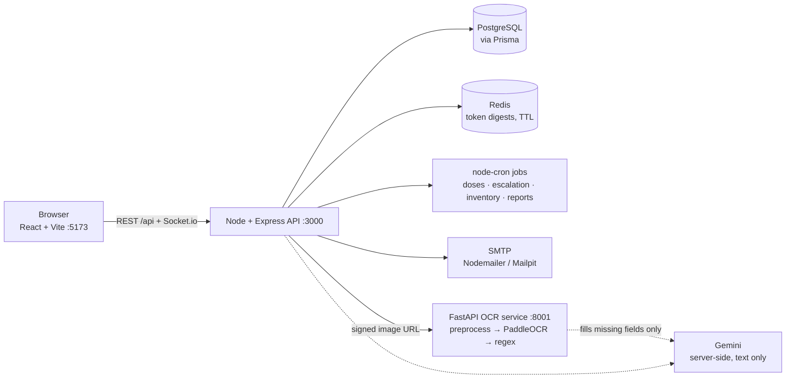

**Why three services?** The best OCR library (PaddleOCR) is Python, while the rest of the app is I/O-heavy and suits Node. PostgreSQL gives relational integrity, Redis holds short-lived revocable tokens, and Docker makes the setup reproducible.

### The "missed dose" story, end to end

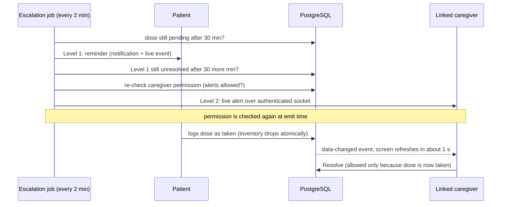

---

## Tech stack

| Layer | Technology |
|---|---|
| **Frontend** | React, Vite, React Router, Context API, Socket.io client |
| **Backend** | Node.js, Express, Prisma 6, PostgreSQL, Redis, Socket.io, node-cron, Nodemailer |
| **OCR service** | Python, FastAPI, uvicorn, PaddleOCR (single worker, model loaded once at startup) |
| **AI** | Google Gemini, server-side, text only |
| **Auth** | bcrypt, JWT access (15 min) and rotating refresh (7 days) tokens, Redis revocation, Google Sign-In |
| **Infrastructure** | Docker Compose (Postgres, Redis), Mailpit for local email |
| **Testing** | `node --test` (API), client unit tests, Playwright with axe (browser and accessibility), real-service scripts |

---

## Engineering highlights

- **Concurrency without app-level locks.** Invitation accepts claim the invite with a conditional update (`where status = 'sent'`), and inventory and escalation use Serializable transactions with retry, backoff and jitter. A concurrent-update flake found during testing dropped from intermittent to **0 failures in 10 runs**.
- **Atomic dose logging.** "Taken" and the inventory decrement commit together. Duplicate taps don't double-charge stock, and stock is floored at zero.
- **Timezone and DST correctness.** "Today" is computed in the patient's timezone, including 23-hour and 25-hour days and India's +5:30 offset, with boundary-millisecond tests.
- **Correct streak maths.** Best streak uses a gap check, and rolling percentages are weighted (total taken ÷ total scheduled), not an average of daily percentages.
- **Taper schedules done right.** The dose amount comes from the step that applied on the **dose's own date**, so a caregiver logging yesterday's dose today still uses yesterday's step. This was caught by reading the code.
- **OCR pipeline that can be measured.** Regex parses the structured fields first (99.31 % accurate on the benchmark). Gemini only fills the blanks and regex wins any conflict. If Gemini fails, the regex output stands. The prompt treats OCR text as an untrusted transcript to defend against prompt injection.
- **Self-recovering scan queue.** Postgres rows act as the queue, so a scan stuck in `processing` is picked up on the next start.
- **Catch-up after downtime.** Dose rows for today are ensured on start and every minute, idempotently, so a restart never leaves an empty day.
- **Green tests are not a configured system.** A smoke test (`verify-local.js`) runs against the real server and real `.env`, after unit tests passed while six SMTP variables were missing.

---

## OCR benchmark

Three engines were compared on **15 synthetic printed prescriptions (45 runs)** before the engine decision was locked. Full report: [`docs/MediTrack_OCR_Benchmark_Report.pdf`](docs/MediTrack_OCR_Benchmark_Report.pdf).

| Engine | Character error rate | Field accuracy | Time per image |
|---|:-:|:-:|:-:|
| **PaddleOCR (chosen)** | **0.10 %** | **99.31 %** | 6.11 s |
| Tesseract | 1.54 % | 98.16 % | 0.36 s |
| EasyOCR | 2.02 % | 86.68 % | 8.53 s |

Accuracy beats speed for medical data, and the extra seconds are hidden by the asynchronous design: the upload returns immediately and a socket event announces the result. These numbers come from **synthetic printed** prescriptions only, so real photographs and handwriting will do worse. That is why human review is mandatory.

---

## Testing and verification

| Layer | Tool | Result |
|---|---|:-:|
| Backend integration (real HTTP → real Postgres and Redis) | `node --test` | **33 pass, 0 fail** |
| Client unit tests | `npm test` | **20 pass** |
| Browser end-to-end and accessibility, at 360 / 768 / 1280 px in light and dark | Playwright + axe | **69 pass**, 2 opt-in skipped |
| Real-service scripts (real DB, Redis, SMTP and Chrome, no mocks) | `phase89-real`, `phase10-real`, `phase11-real` | phase 11: **6 / 6** |
| Live-refresh latency | measured | **0.9–1.2 s** |
| Production build | `npm run build` | passes, 143.88 kB JS gzip |

**What the tests specifically prove:**

- ⚡ **Concurrency:** simultaneous invitation accepts give one `201` and one `409`.
- 🔁 **Atomicity:** a failure injected after the writes but before commit rolls back both the invitation and the link. An audit failure rolls back a permission change.
- 🔐 **Permissions:** the same token with a permission flipped twice gives a different response immediately.
- 🤖 **AI invariants:** every chat row has `disclaimerShown = true`. The `DrugInteraction` table is byte-identical before and after every model call.
- 🕒 **Time:** DST days and the +5:30 offset behave correctly.

Gemini and Google verification are stubbed in the automated backend suite. The real-service scripts use the real Gemini.

---

## Data model

20 PostgreSQL models in five groups. The full schema and sitemap are in [`docs/MediTrack_Website_Schema_and_Sitemap.xlsx`](docs/MediTrack_Website_Schema_and_Sitemap.xlsx).

| Group | Models |
|---|---|
| **Identity and relationships** | `User`, `UserPreference`, `CaregiverPatientLink` (the source of truth for roles), `Invitation` |
| **Medical** | `Doctor`, `Medication`, `PrescriptionScan` |
| **Scheduling and adherence** | `MedicationSchedule`, `DoseLog`, `MedicineInventory`, `AdherenceStat` |
| **Alerts and reports** | `Notification`, `EscalationAlert`, `WeeklySummaryReport` |
| **AI, safety and compliance** | `AiChatConversation`, `AiChatMessage`, `AiInsight`, `DrugInteraction`, `MedicationInteractionFlag`, `AuditLog` |

---

## Getting started

Full step-by-step instructions, checks and troubleshooting are in
[`docs/MediTrack_Complete_Running_and_Testing_Guide.md`](docs/MediTrack_Complete_Running_and_Testing_Guide.md).

**Prerequisites:** Docker Desktop, Node.js 18+, Python 3 with a virtual environment for the OCR service.

| Service | Port |
|---|---|
| PostgreSQL | 5432 |
| Redis | 6379 |
| Backend API | 3000 |
| Frontend (Vite) | 5173 |
| OCR service | 8001 |
| Mailpit UI / SMTP | 8025 / 11025 |

```powershell
# 1. Databases and mail catcher
docker compose up -d --wait
docker start meditrack-mailpit

# 2. First-time setup
cd server
npm install
npx prisma migrate deploy
npx prisma db seed        # loads the 30 reviewed interaction pairs
cd ../client
npm install

# 3. OCR service (its own terminal)
cd ../ocr-service
.\.venv\Scripts\python.exe -m uvicorn main:app --host 127.0.0.1 --port 8001

# 4. Backend and frontend (two more terminals, from the repo root)
npm --prefix server run dev
npm --prefix client run dev
```

Copy `server/.env.example` to `server/.env` and fill in your own values. A Gemini API key is needed for chat, AI schedules and insights, and a Google OAuth client ID for Google Sign-In.
Open **http://localhost:5173**. Verification and reset emails appear in Mailpit at **http://localhost:8025**.

> ⚠️ Never run `prisma migrate reset` or `docker compose down -v` on data you care about.

**Run the tests**

```powershell
cd server;  node --test                     # 33 backend tests
cd client;  npm test                        # 20 unit tests
cd client;  npx playwright test --workers=2 # 69 browser tests
```

---

## Known limitations (stated up front)

Honest engineering matters more than a perfect-looking demo, so these are listed here.

- **Not deployed yet.** Everything runs locally. Deployment is part of Phase 12.
- **OCR is evaluated on synthetic printed prescriptions only.** Real photographs and handwriting are untested, which is why review is mandatory.
- **Interaction coverage is 30 pairs**, exact ingredient names only. *No warning does not mean "safe."*
- **Signed image URLs** last 10 minutes and stay valid for that window even after a caregiver is revoked. Images are stored on the server's disk.
- **Refresh token is kept in `sessionStorage`.** Moving to an httpOnly cookie is planned.
- **Single-instance assumptions:** the scan queue, cron jobs, chat send lock and sockets would need a Redis-backed queue and adapter to scale out.
- **Push and SMS** are not delivered. In-app and email only.
- **No account deletion or data export yet**, and no regulatory compliance (HIPAA, GDPR) is claimed.
- **No load testing**, and no real-device or screen-reader testing.

## Roadmap (Phase 12 and beyond)

- Unit tests for escalation timing, OCR-to-database mapping, adherence maths, inventory maths and Google account resolution.
- Hardening: httpOnly refresh cookie, login rate limiting, production environment validation, uniqueness constraints on dose logs.
- Deployment: managed Postgres, Redis, Node and OCR hosting, and the client on a static host.
- Product: web push, SMS, data export and delete, a larger licensed interaction dataset, and a real-photo OCR re-benchmark.

The full plan is in [`docs/MediTrack_Roadmap_v3.pdf`](docs/MediTrack_Roadmap_v3.pdf).

---

## Documentation

| Document | What it covers |
|---|---|
| [Running and Testing Guide](docs/MediTrack_Complete_Running_and_Testing_Guide.md) | Start every service, run every test, inspect the database, troubleshooting |
| [Schema and Sitemap (Excel)](docs/MediTrack_Website_Schema_and_Sitemap.xlsx) | All 20 models and every page |
| [Roadmap v3](docs/MediTrack_Roadmap_v3.pdf) | Phases 0–12 and design decisions |
| [OCR Benchmark Report](docs/MediTrack_OCR_Benchmark_Report.pdf) | The 3-engine comparison behind the OCR decision |

---

## Disclaimer

MediTrack is a personal learning and portfolio project. It does **not** give medical advice. Its AI replies and interaction warnings are not a substitute for a doctor or pharmacist.

<div align="center">

**Built by [Pratham](https://github.com/Prathamlm30)**, B.Tech ECE (Industrial IoT), NIT Kurukshetra

</div>
